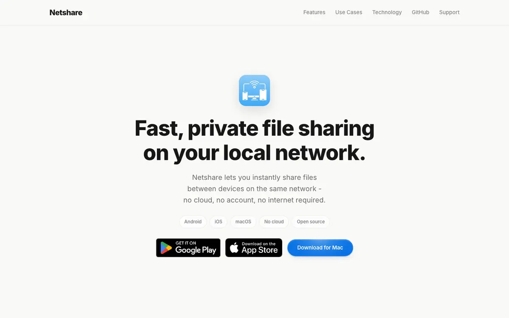
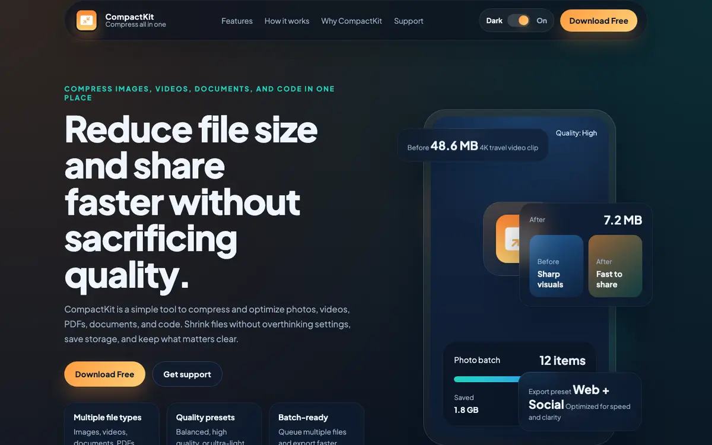
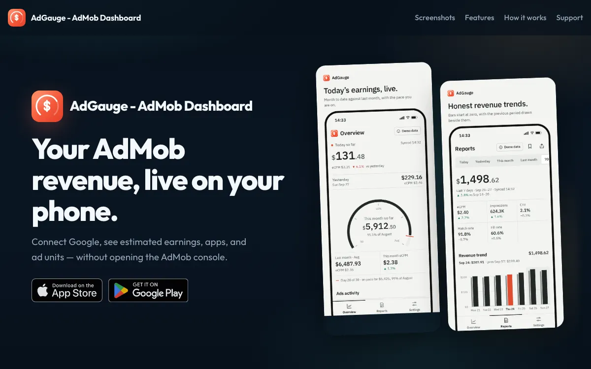
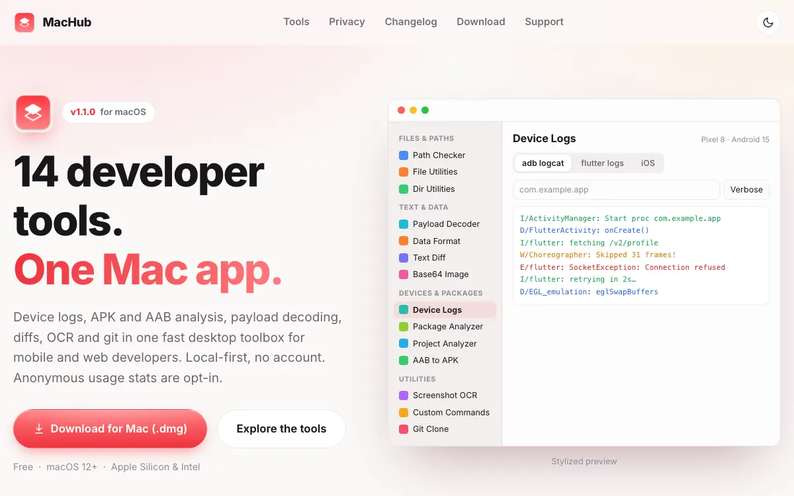
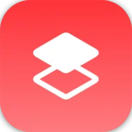
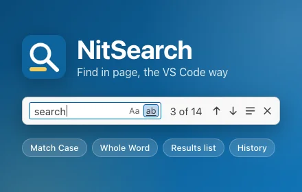
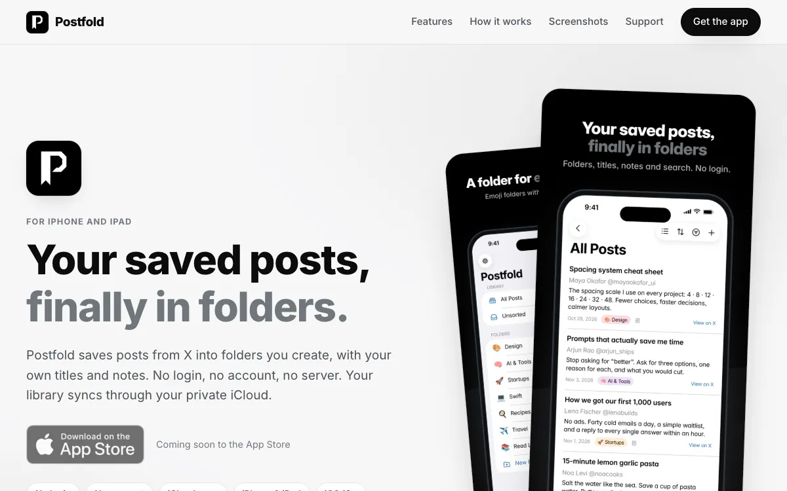
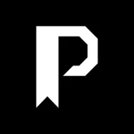

# Indie Products

Apps and tools I design, build, and ship on my own, from the first commit to the store listing. Open a product to see what it does, how it looks, and where to get it.

<section class="project-grid" aria-label="Indie products" markdown>

<article class="project-card project--netshare" markdown>

##  [NetShare](products/netshare.md)

Fast, private file sharing on your local network. No cloud, no account, no internet required.

<ul class="project-tags" aria-label="Platforms and license">
<li>Android</li>
<li>iOS</li>
<li>macOS</li>
<li>Free & open source</li>
</ul>

[Explore NetShare](products/netshare.md) [netfshare.site](https://netfshare.site/)

</article>

<article class="project-card project--compactkit" markdown>

##  [CompactKit](products/compactkit.md)

Compress images, videos, PDFs, documents, and code in one place, without sacrificing quality.

<ul class="project-tags" aria-label="Platforms and pricing">
<li>iOS</li>
<li>Android</li>
<li>Free download</li>
<li>On-device</li>
</ul>

[Explore CompactKit](products/compactkit.md) [compactkit.cc](https://compactkit.cc/)

</article>

<article class="project-card project--adgauge" markdown>

##  [AdGauge](products/adgauge.md)

Your AdMob revenue, live on your phone. Earnings, apps, and ad units without opening the AdMob console.

<ul class="project-tags" aria-label="Platforms and pricing">
<li>iOS</li>
<li>Android</li>
<li>Free download</li>
<li>Read-only access</li>
</ul>

[Explore AdGauge](products/adgauge.md) [admob-dashboard.site](https://admob-dashboard.site/)

</article>

<article class="project-card project--machub" markdown>

##  [MacHub](products/machub.md)

14 developer tools in one Mac app: device logs, APK and AAB analysis, payload decoding, diffs, OCR, and git.

<ul class="project-tags" aria-label="Platform and pricing">
<li>macOS</li>
<li>Apple Silicon & Intel</li>
<li>Free</li>
<li>No account</li>
</ul>

[Explore MacHub](products/machub.md) [machub.space](https://machub.space/)

</article>

<article class="project-card project--nitsearch" markdown>

##  [NitSearch](products/nitsearch.md)

Find in page, the VS Code way: highlight all matches, match case, whole word, a results list, and search history.

<ul class="project-tags" aria-label="Platform and privacy">
<li>Chrome extension</li>
<li>Free</li>
<li>No data collected</li>
</ul>

[Explore NitSearch](products/nitsearch.md) [Chrome Web Store](https://chromewebstore.google.com/detail/nitsearch/edipjijflaedhppheghdneaffbaeipdj)

</article>

<article class="project-card project--postfold" markdown>

##  [Postfold](products/postfold.md)

Save posts from X into your own folders, with custom titles, notes, sorting, and search. No login, synced through iCloud.

<ul class="project-tags" aria-label="Platforms and status">
<li>iPhone & iPad</li>
<li>iOS 18+</li>
<li>No login</li>
<li>Coming soon</li>
</ul>

[Explore Postfold](products/postfold.md) [postfold.space](https://postfold.space/)

</article>

</section>

<aside class="store-callout project--hugetree" markdown>

<h2 id="hugetree" data-toc-label="HugeTree" markdown="span">More apps and games on HugeTree</h2>

HugeTree is my store of free apps and games, from handy tools like QR Scanner and Video To Photo to casual puzzle games such as Pixel Dunes and Block Puzzle Brick 1010.

[Visit hugetree.store](https://hugetree.store/) [Apps](https://hugetree.store/apps) [Games](https://hugetree.store/games)

</aside>

Curious how these get shipped? I wrote about [publishing a landing page with a custom domain for your product](posts/publish-a-landing-page-with-a-custom-domain-for-your-product.md). Looking for libraries instead of apps? See my open-source [Flutter packages](packages.md).
