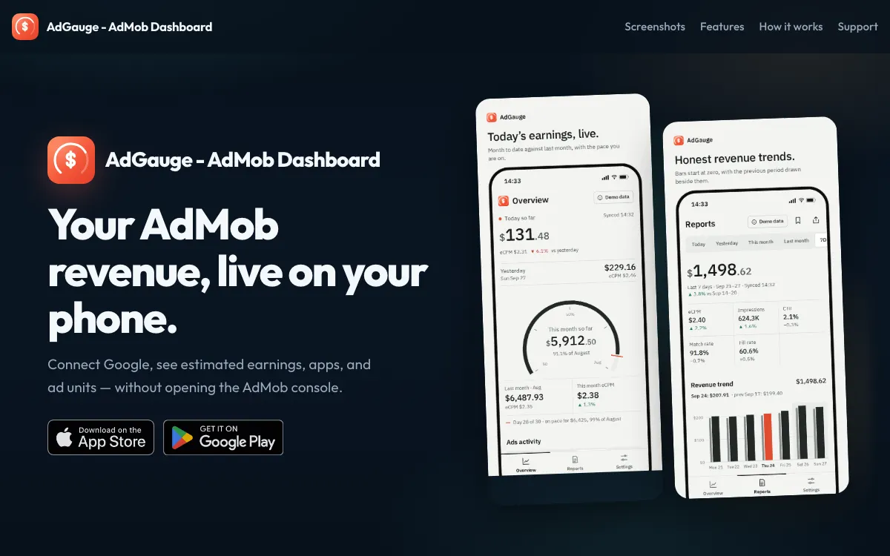
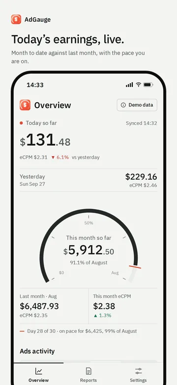
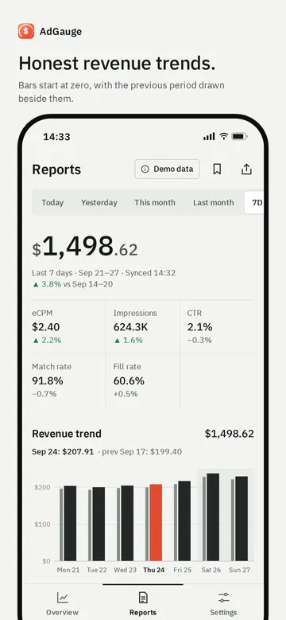
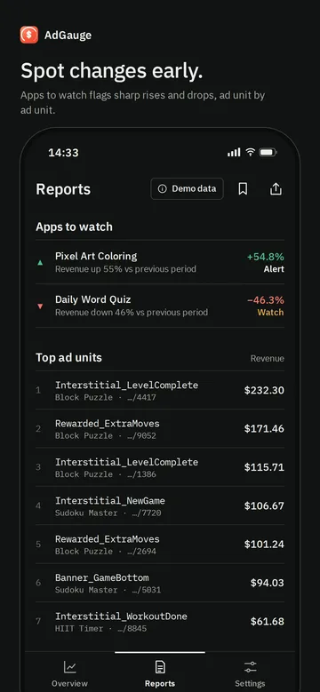
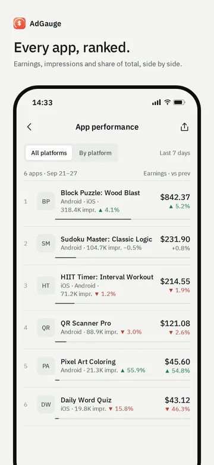
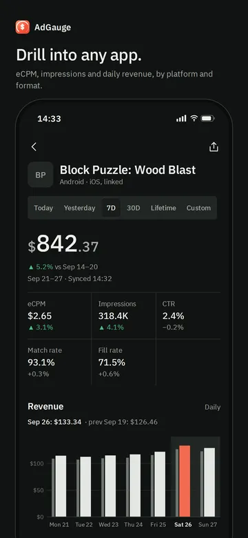

# AdGauge

<header class="project-hero project--adgauge" markdown>

Your AdMob revenue, live on your phone. Earnings, apps, and ad units at a glance, without opening the AdMob console.

<ul class="project-tags" aria-label="Platforms and pricing">
<li>iOS</li>
<li>Android</li>
<li>Free download</li>
<li>Read-only access</li>
</ul>

[Visit admob-dashboard.site](https://admob-dashboard.site/) [App Store](https://apps.apple.com/app/id6809818957) [Google Play](https://play.google.com/store/apps/details?id=com.adgauge.admobdashboard)

</header>

<figure class="site-preview">
<a href="https://admob-dashboard.site/">
admob-dashboard.site

</a>
<figcaption>A preview of admob-dashboard.site. Click it to open the live landing page.</figcaption>
</figure>

## What it is

AdGauge is a personal AdMob dashboard for app publishers. Sign in with the Google account that has AdMob access, and it pulls mediated revenue and performance straight from Google's AdMob Reporting API into screens made for a phone. No more opening the AdMob console on a laptop just to see how today is going.

## Highlights

- **Estimated earnings**: today so far, yesterday, this month, and last month, so you can check the pulse in seconds.
- **Ads activity**: earnings, requests, impressions, match rate, eCPM, and show rate, compared against recent periods.
- **Your dashboard**: hero revenue with flexible ranges, a revenue trend chart, and your top ad units ranked.
- **Per-app drill-down**: format performance, revenue charts, top countries, and platform breakdown, including lifetime and custom ranges.
- **Read-only Google Sign-In**: the app asks only for the AdMob read-only scope, and you can disconnect anytime.
- **Light and dark themes**: plus default ranges you can customize.

## How it works

1. **Connect Google**: sign in with the account that has AdMob access.
2. **Sync AdMob**: pull live revenue, impressions, match rate, eCPM, apps, and ad units from the AdMob API.
3. **Track daily**: switch ranges, pull to refresh, and drill into any app when you want a closer look.

## Screenshots

## Who it's for

- **Indie developers** who want to know how their apps earned today without opening a laptop.
- **Small studios** keeping an eye on a portfolio of apps and the ad units that matter most.

## Under the hood

AdGauge is built with [Flutter](https://flutter.dev/) for Android and iOS. It signs in with Google using the `admob.readonly` scope and reads the AdMob Reporting API directly from your device. There is no AdGauge server in between storing your metrics.

## Links

- **Website**: [admob-dashboard.site](https://admob-dashboard.site/)
- **iPhone and iPad**: [App Store](https://apps.apple.com/app/id6809818957)
- **Android**: [Google Play](https://play.google.com/store/apps/details?id=com.adgauge.admobdashboard)
- **Help**: [Support](https://admob-dashboard.site/support/)

[← All indie products](../products.md)
