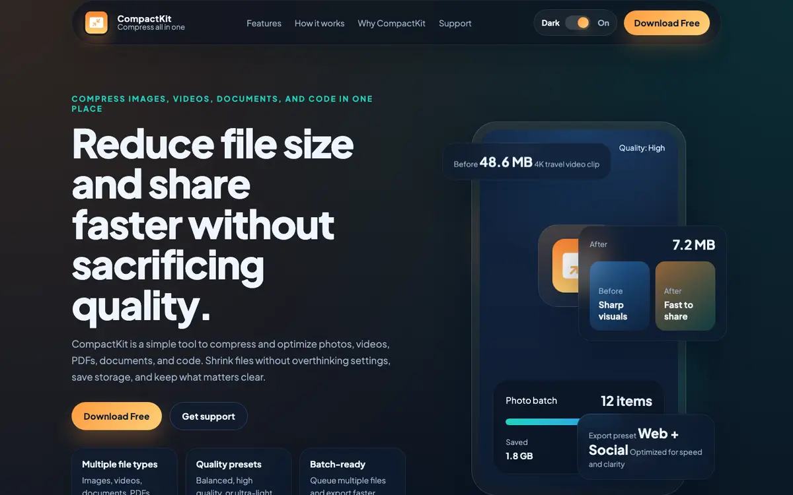
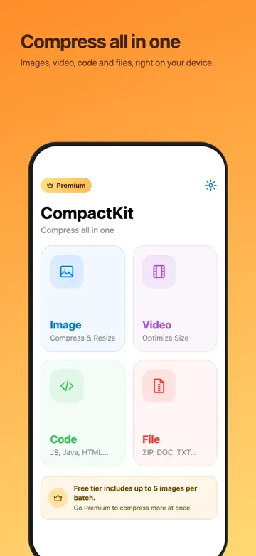
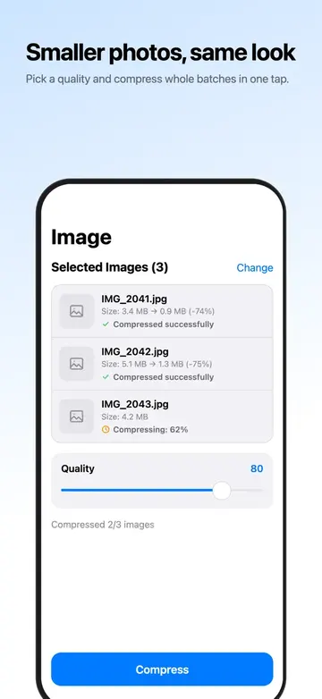
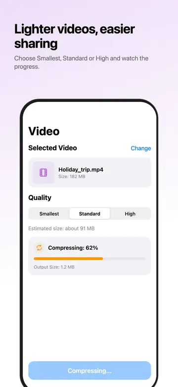
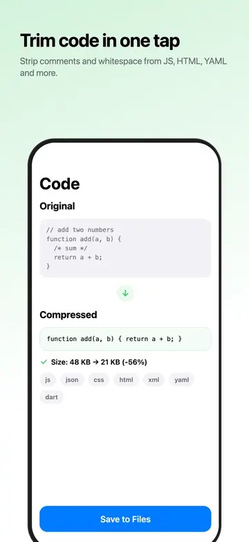

# CompactKit

<header class="project-hero project--compactkit" markdown>

Compress images, videos, documents, and code in one place. Smaller files, faster sharing, same quality.

<ul class="project-tags" aria-label="Platforms and pricing">
<li>iOS</li>
<li>Android</li>
<li>Free download</li>
<li>On-device</li>
</ul>

[Visit compactkit.cc](https://compactkit.cc/) [App Store](https://apps.apple.com/app/id6761741587) [Google Play](https://play.google.com/store/apps/details?id=com.app.compactkit)

</header>

<figure class="site-preview">
<a href="https://compactkit.cc/">
compactkit.cc

</a>
<figcaption>A preview of compactkit.cc. Click it to open the live landing page.</figcaption>
</figure>

## What it is

CompactKit replaces the handful of apps you would otherwise juggle to shrink files. Pick images, videos, PDFs, documents, or code, choose a preset, and export share-ready results. Compression runs on your device, so files are not uploaded anywhere to get smaller.

## Highlights

- **Image compression**: reduce photo size for web, chat, or storage without flattening detail.
- **Video optimization**: slim down heavy clips for quick sharing while keeping playback smooth.
- **Document cleanup**: shrink PDFs and documents so they are easier to upload, email, and archive.
- **Code minification**: strip comments and whitespace from JS, CSS, HTML, JSON, YAML, and more.
- **Batch workflows**: queue several files and process them in one pass.
- **Quality presets**: switch between balanced, high quality, and ultra-light in a tap.

## How it works

1. **Import your files**: pick images, videos, PDFs, documents, or code straight from your device.
2. **Pick a preset**: decide what matters most, whether that is quality, size, or speed.
3. **Export and share**: save the optimized files and send them anywhere without waiting on huge uploads.

## Screenshots

## Who it's for

- **Creators and designers** shrinking photos, videos, and presentation packs before sharing them.
- **Teams and operators** sending PDFs, documents, and short clips with faster uploads.
- **Developers** minifying code and preparing lighter assets for delivery.

## Behind the build

Posts I wrote while building and shipping CompactKit:

- [How to prevent Jetsam/OOM crashes on iOS in Flutter media flows](../posts/how-to-prevent-jetsam-oom-crash-on-ios-in-flutter-media-flow.md)
- [Publishing your Flutter iOS app to the App Store with ASC CLI](../posts/publishing-your-flutter-ios-app-to-the-app-store-with-asc-cli.md)

## Links

- **Website**: [compactkit.cc](https://compactkit.cc/)
- **iPhone and iPad**: [App Store](https://apps.apple.com/app/id6761741587)
- **Android**: [Google Play](https://play.google.com/store/apps/details?id=com.app.compactkit)
- **Help**: [Support](https://compactkit.cc/support/)

[← All indie products](../products.md)
