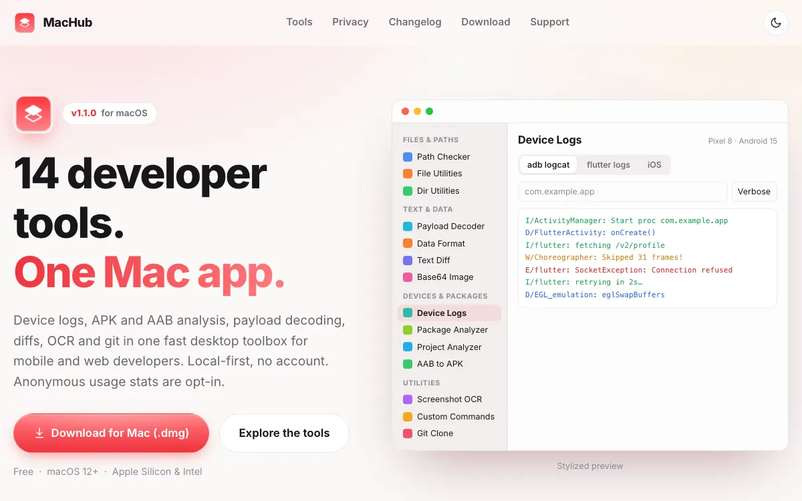

# MacHub

<header class="project-hero project--machub" markdown>

14 developer tools, one Mac app. Device logs, APK and AAB analysis, payload decoding, diffs, OCR, and git in a single toolbox.

<ul class="project-tags" aria-label="Platform and pricing">
<li>macOS 12+</li>
<li>Apple Silicon & Intel</li>
<li>Free</li>
<li>No account</li>
</ul>

[Visit machub.space](https://machub.space/) [Download for Mac](https://machub.space/download/)

</header>

<figure class="site-preview">
<a href="https://machub.space/">
machub.space

</a>
<figcaption>A preview of machub.space. Click it to open the live landing page.</figcaption>
</figure>

## What it is

MacHub gathers the small tools mobile and web developers reach for every day into one fast desktop app. Fourteen tools sit in four groups in a single sidebar, and each one keeps its state while you switch, so you never lose your place.

It is local-first: there is no account and no ads, and anonymous usage statistics are sent only if you opt in.

## The toolbox

- **Files & Paths**: Path Checker, File Utilities, and Dir Utilities to check paths, bookmark the files you edit often, and open workspace folders in Finder, VS Code, Cursor, Android Studio, Xcode, and more.
- **Text & Data**: Payload Decoder, Data Format, Text Diff, and Base64 Image for tokens, JSON, XML, YAML, CSV, SQL, side-by-side diffs, and base64 images.
- **Devices & Packages**: Device Logs, Package Analyzer, Project Analyzer, and AAB to APK for logs, APK/AAB/IPA inspection, codebase stats, and installable builds.
- **Utilities**: Screenshot OCR, Custom Commands, and Git Clone for reading text off the screen, running saved shell commands, and cloning with the right account.

## Highlights

- **Android release workflow**: drop an `.aab` to inspect it, convert it to a universal APK with bundletool, sign it, and install it on a connected phone without leaving the app.
- **Layered payload decoding**: unwraps JWT, JSON, URL encoding, hex, Gzip, and Base64 up to eight layers deep, then shows the result as a JSON tree.
- **Live device logs**: `adb logcat`, `flutter logs`, and iOS syslog for devices and simulators, with level, package, and text filters.
- **On-device OCR**: select any region of the screen and read its text with Apple Vision, then translate it into 15 languages if you want.
- **Multi-account git clone**: matches the URL to the `Host` aliases in your `~/.ssh/config`, so `origin` uses the correct key from the start.
- **Works with your toolchain**: finds `adb`, `flutter`, `bundletool`, `git`, `java`, and `xcrun` in the usual places, and shows an install hint when one is missing.

## Who it's for

- **Android and Flutter developers** who live in logcat, bundletool, and APK builds.
- **Mobile and web developers** who decode tokens, format payloads, and diff responses all day.
- **Anyone juggling several git accounts** on one Mac.

## Privacy and install

Bookmarks, saved commands, and history stay in your Mac's local preferences, and network requests such as translation happen only when you ask for them. MacHub launches tools like `adb`, `git`, and `bundletool`, so it runs outside the App Sandbox. That is why it ships as a signed, notarized DMG from its website instead of the Mac App Store. It runs on macOS 12 Monterey or later, on both Apple Silicon and Intel.

## Links

- **Website**: [machub.space](https://machub.space/)
- **macOS DMG**: [Download for Mac](https://machub.space/download/)
- **What's new**: [Changelog](https://machub.space/changelog/)
- **Help**: [Support and FAQ](https://machub.space/support/)

[← All indie products](../products.md)
