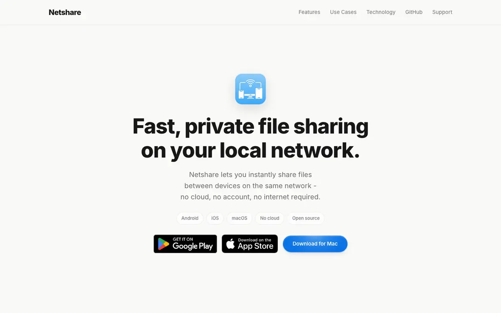
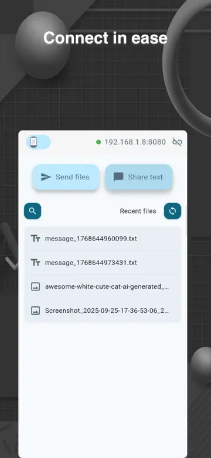
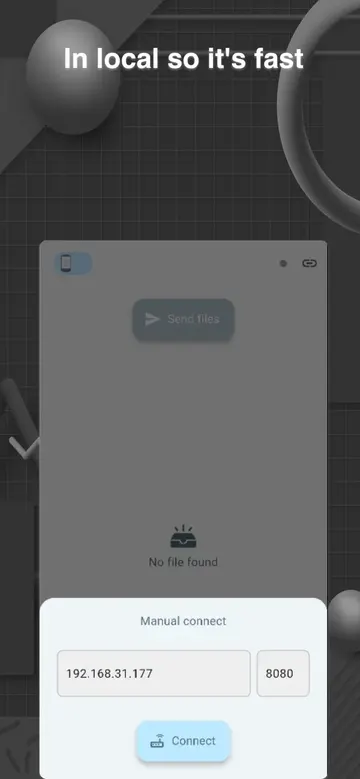
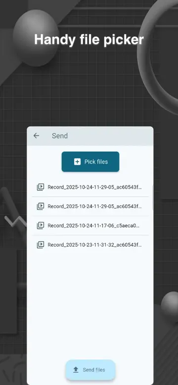

# NetShare

<header class="project-hero project--netshare" markdown>

Fast, private file sharing on your local network. No cloud, no account, no internet required.

<ul class="project-tags" aria-label="Platforms and license">
<li>Android</li>
<li>iOS</li>
<li>macOS</li>
<li>Free & open source</li>
</ul>

[Visit netfshare.site](https://netfshare.site/) [App Store](https://apps.apple.com/app/id6758239332) [Google Play](https://play.google.com/store/apps/details?id=com.app.netshare) [Download for Mac](https://netfshare.site/download-macos/)

</header>

<figure class="site-preview">
<a href="https://netfshare.site/">
netfshare.site

</a>
<figcaption>A preview of netfshare.site. Click it to open the live landing page.</figcaption>
</figure>

## What it is

NetShare moves files directly between devices on the same Wi-Fi or local network. Nothing goes through a cloud service, there is no account to create, and it keeps working when the network has no internet access at all.

Use it between two computers, between a computer and a phone, or between two phones, across Android, iOS, and macOS.

## Highlights

- **Local-first and fast**: files travel straight across your network instead of through a server.
- **Private by design**: your files stay on your network. Transfers never touch an external server.
- **Works offline**: made for offices, labs, factories, and internal networks where the internet is restricted or unavailable.
- **Cross-platform**: one app on Android, iOS, and macOS.
- **Open source**: the code is on [GitHub](https://github.com/NetShareOSS/netshare) under the Apache-2.0 license.

## Screenshots

## Who it's for

- **Internal teams**: share HR documents, source code, and design files when cloud tools are blocked.
- **Factories and industrial sites**: reliable transfers on isolated networks with no internet access.
- **Schools, labs, and hospitals**: keep sensitive data on-premises while still working together quickly.
- **Dev teams and studios**: move large builds, exports, and media assets between machines without waiting on uploads.

## Under the hood

NetShare is built with [Flutter](https://flutter.dev/), so one codebase runs on every platform with a consistent UI. On Android it relies on [netshare_saf](../packages.md#netshare_saf), a plugin I wrote to reach the Storage Access Framework. On macOS it ships both through the Mac App Store and as a signed, notarized DMG.

## Behind the build

Posts I wrote while building and shipping NetShare:

- [How to build a signed and notarized macOS DMG on Flutter](../posts/how-to-build-a-signed-and-notarized-macos-dmg-on-flutter.md)
- [Introduction to NetShare - Flutter opensource project](../posts/introduction-to-netshare-flutter-opensource-project.md)
- [Releasing Flutter projects on GitHub](../posts/releasing-flutter-projects-on-github.md)
- [Crafting responsive Desktop UI for OverlayEntry in Flutter](../posts/crafting-responsive-desktop-ui-for-overlayentry-in-flutter.md)
- [Streamlining exiting your Flutter desktop app with Shortcut keys](../posts/streamlining-exiting-your-flutter-desktop-app-with-shortcut-keys.md)

## Links

- **Website**: [netfshare.site](https://netfshare.site/)
- **iPhone, iPad, and Mac**: [App Store](https://apps.apple.com/app/id6758239332)
- **Android**: [Google Play](https://play.google.com/store/apps/details?id=com.app.netshare)
- **macOS DMG**: [Download for Mac](https://netfshare.site/download-macos/)
- **Source code**: [NetShareOSS/netshare](https://github.com/NetShareOSS/netshare)
- **Updates**: [X](https://x.com/NetShareOSS) · [YouTube](https://www.youtube.com/@NetShareOSS)
- **Help**: [Support](https://netfshare.site/support/)

[← All indie products](../products.md)
