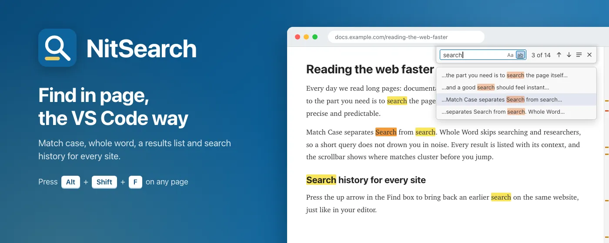
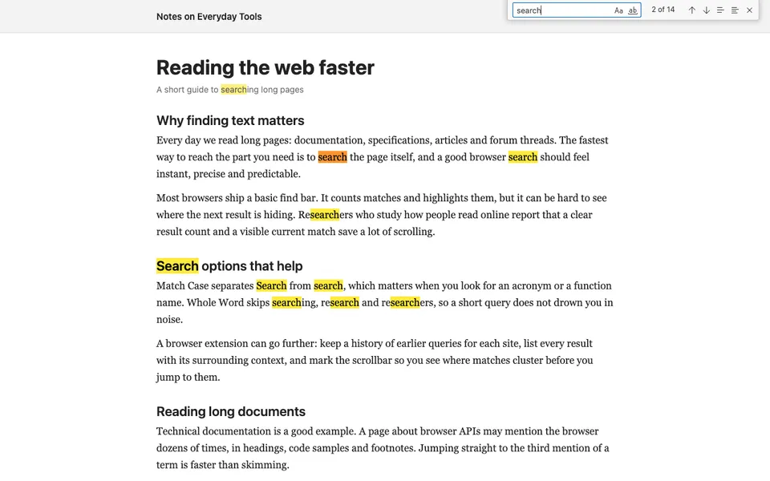
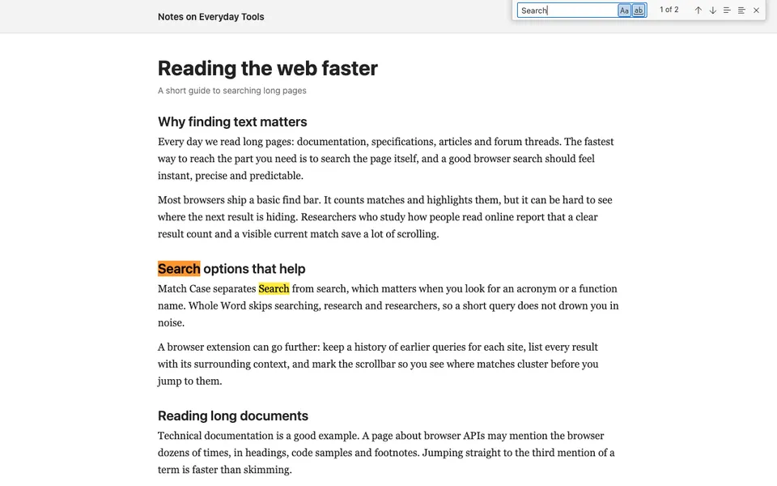
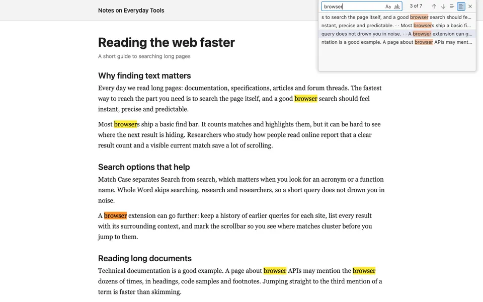
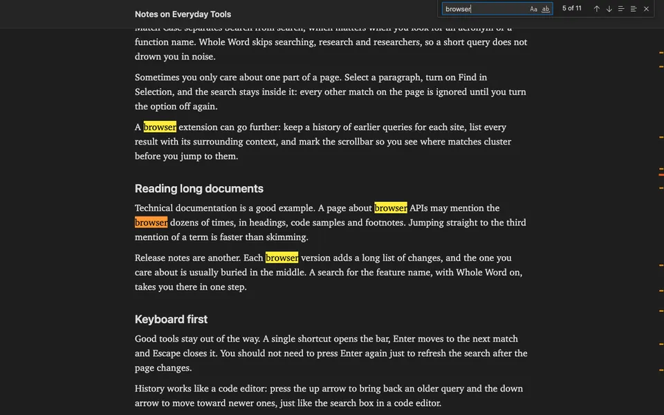
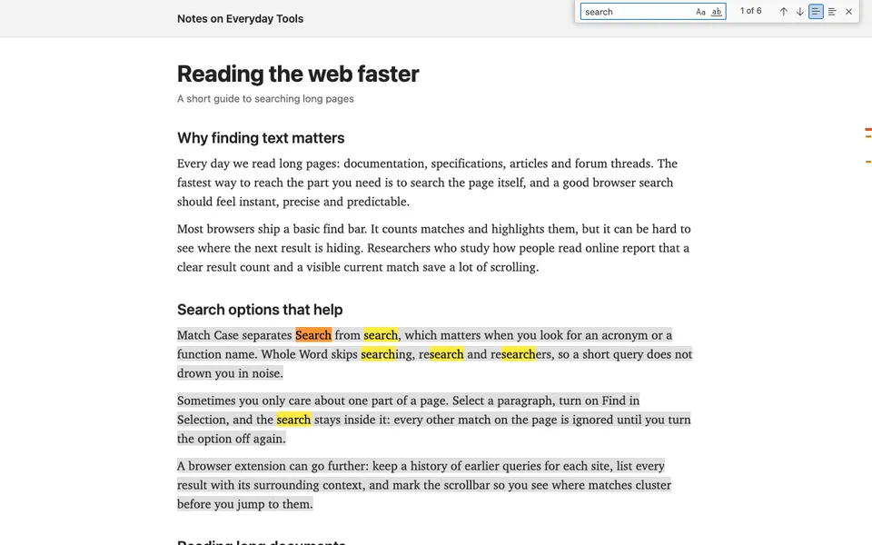

# NitSearch

<header class="project-hero project--nitsearch" markdown>

Find in page, the VS Code way. Match case, whole word, a results list, and search history for every site.

<ul class="project-tags" aria-label="Platform and privacy">
<li>Chrome extension</li>
<li>Free</li>
<li>Keyboard-first</li>
<li>No data collected</li>
</ul>

[Add to Chrome](https://chromewebstore.google.com/detail/nitsearch/edipjijflaedhppheghdneaffbaeipdj) [Privacy policy](https://sites.google.com/view/nitsearch/nitsearchprivacy)

</header>

<figure class="site-preview">

<figcaption>NitSearch on the Chrome Web Store. Click it to open the listing.</figcaption>
</figure>

## What it is

The browser's built-in find bar counts and highlights matches, but it is easy to lose track of where the next result is hiding. NitSearch swaps it for a find widget modeled on the one in VS Code. Press <kbd>Alt</kbd>+<kbd>Shift</kbd>+<kbd>F</kbd> on any page, start typing, and every match lights up, with the current one marked and a list of results you can jump between.

## Highlights

- **Highlight all matches**: every hit is marked, the current one stands out, and a live counter shows where you are.
- **Match Case and Whole Word**: tell `Search` apart from `search`, and skip `searching` or `researchers` when you only want the word itself.
- **Results list**: see each match with its surrounding text and jump straight to the one you need.
- **Scrollbar markers**: spot where matches cluster on a long page before you scroll.
- **Find in Selection**: select a paragraph and keep the search inside it.
- **Search history per site**: press the up and down arrows to bring back recent queries for the website you are on, like in a code editor.

## Screenshots

## Who it's for

- **Developers** digging through long docs, specs, and changelogs.
- **Students and researchers** hunting for exact terms in long articles.
- **Anyone** who wishes the browser's find bar worked like their code editor.

## Privacy

NitSearch runs only in the tab where you click its icon or press the shortcut, and it reads that page inside your browser to find matches. There are no analytics, ads, trackers, or remote servers, and it never loads remote code. Your preferences and recent queries stay in the browser's local extension storage and are deleted when you remove the extension.

## Links

- **Install**: [Chrome Web Store](https://chromewebstore.google.com/detail/nitsearch/edipjijflaedhppheghdneaffbaeipdj)
- **Privacy**: [Privacy policy](https://sites.google.com/view/nitsearch/nitsearchprivacy)
- **Say thanks**: [Buy me a coffee](https://buymeacoffee.com/huynguyennovem)

[← All indie products](../products.md)
