# Postfold

<header class="project-hero project--postfold" markdown>

Your saved posts from X, finally in folders. Add your own titles and notes, then sort, filter, and search them, with no login and no account.

<ul class="project-tags" aria-label="Platforms and status">
<li>iPhone & iPad</li>
<li>iOS 18+</li>
<li>No login</li>
<li>Coming soon to the App Store</li>
</ul>

[Visit postfold.space](https://postfold.space/) [How it works](https://postfold.space/how-it-works/)

</header>

<figure class="site-preview">
<a href="https://postfold.space/">
postfold.space
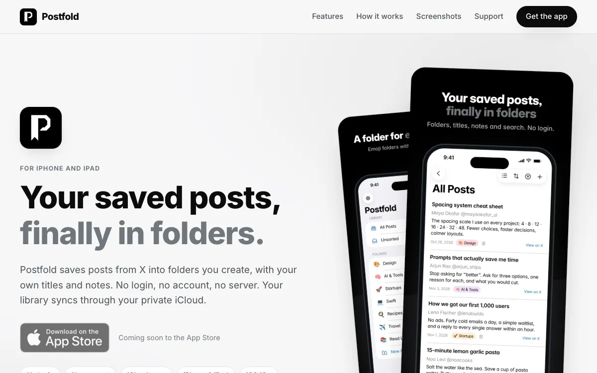
</a>
<figcaption>A preview of postfold.space. Click it to open the live landing page.</figcaption>
</figure>

## What it is

Bookmark folders on X are a Premium feature, so most saved posts end up in one long list. Postfold gives every post you save a home: folders you create, with your own title and a private note so you remember why you kept it. There is nothing to sign in to, and your library syncs between iPhone and iPad through your private iCloud.

Postfold is an independent app and is not affiliated with X Corp.

## Highlights

- **Save in two taps**: share a post from the X app, pick a folder, and add a note right in the Share sheet.
- **A folder for every idea**: as many folders as you like, each with its own emoji, color, and live post count.
- **Make every save yours**: give posts a custom title and a private note.
- **Sort, filter, and search**: sort by date added, date modified, date posted, title, or author, filter by date range, author, note, or status, and search across text, authors, titles, and notes.
- **List, compact, or grid**: pick the layout per folder. On iPad, folders, posts, and details sit side by side.
- **Handles deleted posts**: if a post disappears from X, Postfold marks it Unavailable and keeps your link, title, and note.

## How it works

1. **Tap Share on a post**: in the X app, choose Postfold from the Share sheet, or just copy the post's link.
2. **Pick a folder**: choose one or create a new one, add a note if you like, and tap Save.
3. **Find it later**: sort, filter, and search your saves, then tap Open in X to read the post in the X app.

## Screenshots

### iPhone

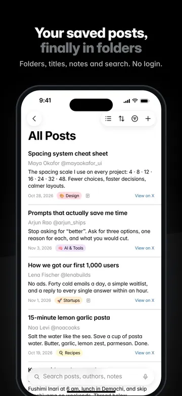
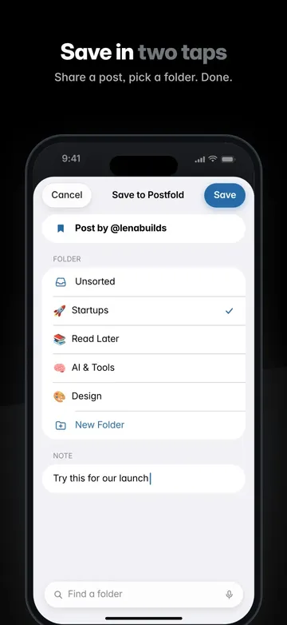
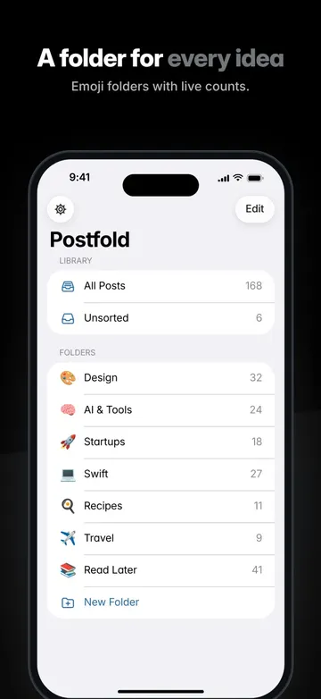
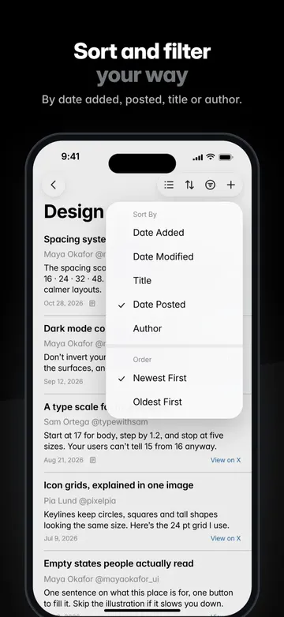
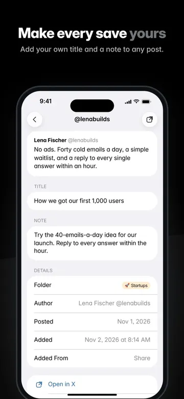
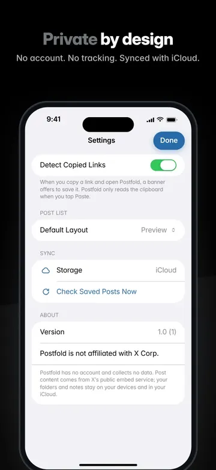

### iPad

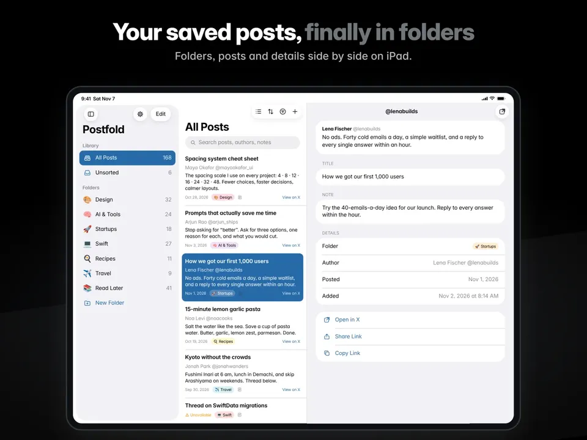
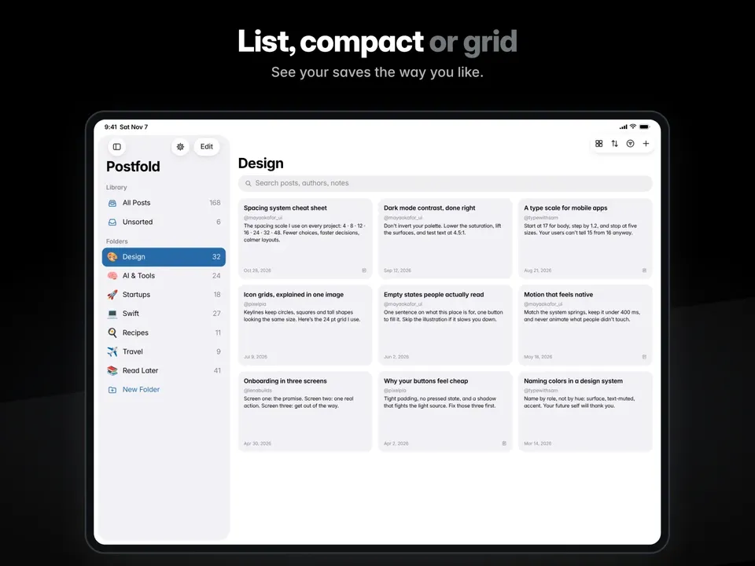
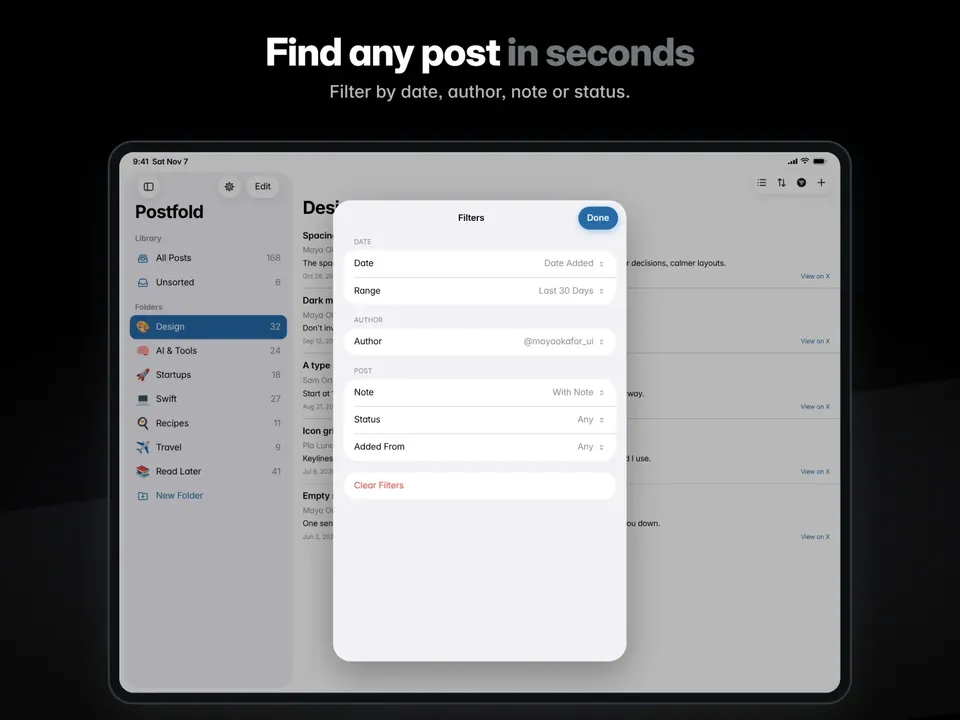
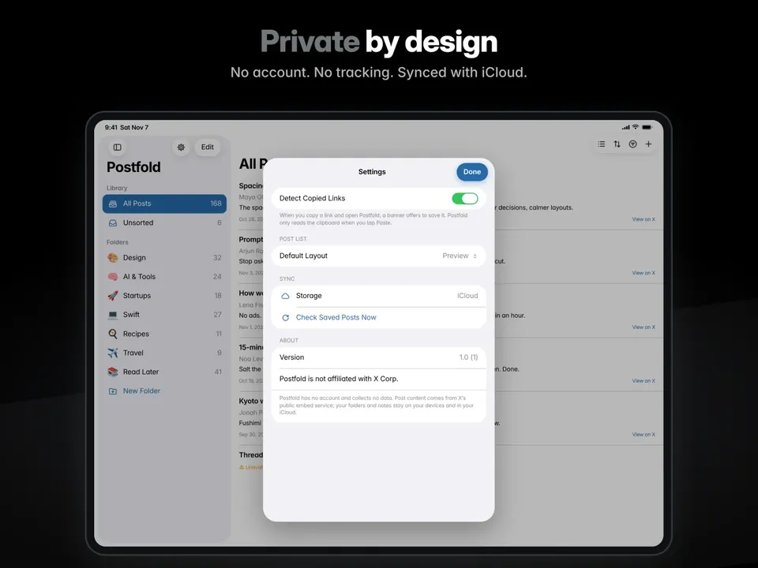

## Who it's for

- **Heavy X readers** who save threads, tips, and links but don't want to pay for bookmark folders.
- **Designers, developers, and researchers** building a personal library of posts to come back to.
- **Anyone using both iPhone and iPad** who wants the same folders on each.

## Under the hood

Postfold is a native app built with SwiftUI and Swift 6. Your library is stored with SwiftData and synced through the private CloudKit database in your iCloud, so there is no Postfold server. Post content comes only from X's public oEmbed service, and the app never connects to your X account. A Share Extension drops each new save into a shared inbox that the main app imports when it opens, which keeps saving fast.

## Privacy

Your folders, posts, and notes stay on your devices and in your private iCloud, and the developer cannot see them. Postfold shows ads from Google AdMob behind Google's consent form and the iOS tracking prompt, and ad requests never include anything from your library. Crash reports come only through Apple's built-in tools, and you can turn them off.

## Links

- **Website**: [postfold.space](https://postfold.space/)
- **Details**: [How it works](https://postfold.space/how-it-works/) and [Technology](https://postfold.space/technology/)
- **Privacy**: [Privacy policy](https://postfold.space/privacy/)
- **Help**: [Support](https://postfold.space/support/)

[← All indie products](../products.md)
